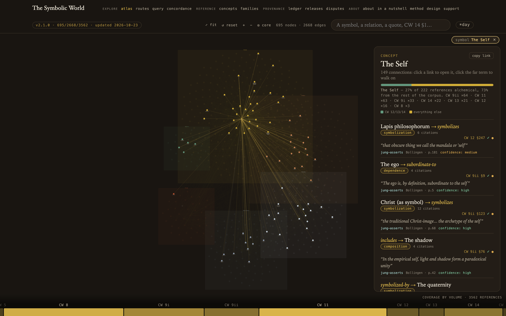

# The Symbolic World

An atlas of C. G. Jung's Collected Works. Each connection between two concepts carries a verbatim quote of at most 25 words, with its volume and paragraph, so a reader can check it against the book.

Live atlas: [symbolicworld.observer](https://symbolicworld.observer). Paper: [docs/PAPER.md](docs/PAPER.md). How to cite: see [CITATION.cff](CITATION.cff).

The graph holds 695 concepts, 2668 relations and 3562 citations as of release v2.1.0. The live atlas grows as mining continues.

### Three ways in

- Explore the atlas at symbolicworld.observer, or start from the ranked concepts index.
- Query the graph from the command line with `tools/query/kg_query.py`.
- Dispute an edge: every citation in the atlas expands to a record and a button that copies a prefilled report. Open it as a [GitHub issue](https://github.com/damianspendel/symbolic-world/issues).

### Project status

Mining of the Collected Works has finished CW 8, 9i, 9ii, 11, 12, 13 and 14. CW 5 and CW 16 are on hold. Issues get a reply within seven days.

## Dispute an edge

Every citation in the atlas expands to its verification record and a **dispute
button** that copies a prefilled report. Submit it as a
[GitHub issue](https://github.com/damianspendel/symbolic-world/issues) — disputed
edges are re-reviewed with your objection attached, and outcomes (upheld /
corrected / removed) are published here. If a cited paragraph does not support
its edge, that finding falsifies the edge, publicly.

## Repository map

| Path | Contents |
|---|---|
| `seed.json` | The graph: nodes, edges, references with full verification provenance |
| `docs/PAPER.md` | Research paper (methods, experiments E0–E10, results) |
| `docs/experiments/` | Every experiment: designs, keys, verdicts, adjudications |
| `docs/ASSUMPTIONS.md` | 16-item assumptions register + community-verification protocol |
| `docs/LEGAL.md` | Legal statement (quotation basis, licensing, takedown) |
| `pipeline/` | Construction pipeline: runners, transaction ledger (`state.json`), batches |
| `tests/test_graph.py` | Integrity validators + 7 self-testing corruption canaries |
| `web/` | The atlas web app (Vite + Cytoscape) |
| `james/` | Second-corpus replication (James, *Varieties*): full reproduction package + [visual graph](https://symbolicworld.observer/james.html) |
| `manage.sh` | Build / deploy / service management |

## Copyright posture

The Collected Works texts are **not** in this repository and never were. Only ≤25-word
attributed quotations, § numbers, and page numbers are published, in reliance on
quotation and fair-use exceptions. The licence terms (MIT for the code, CC BY 4.0
for the dataset's original structure and metadata, the quotations excluded from
both) are in [NOTICE](NOTICE), and the full position, including the takedown
commitment, is in [docs/LEGAL.md](docs/LEGAL.md).

## Authorship

Damian Spendel, with AI collaborators: Claude Opus 4.8 and Opus 5 (proposal),
Claude Fable 5 (verification, and the drafting of the paper), Gemini 3.1 Pro
(cross-vendor audit, and the checking of the paper's claims), Claude Code
(orchestration). See the AI-use disclosure on the paper's title page.
