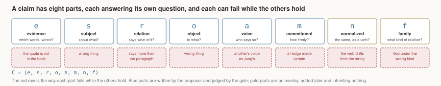
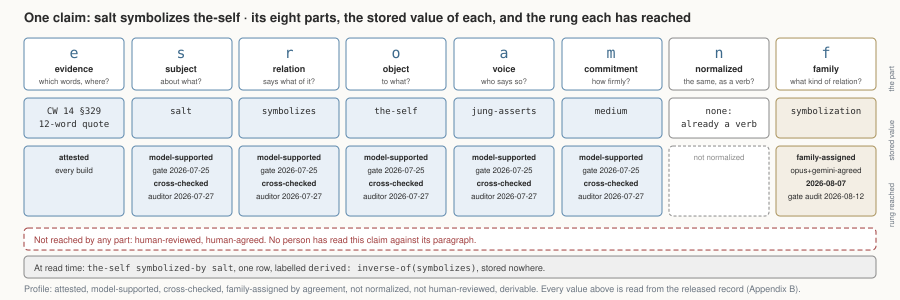
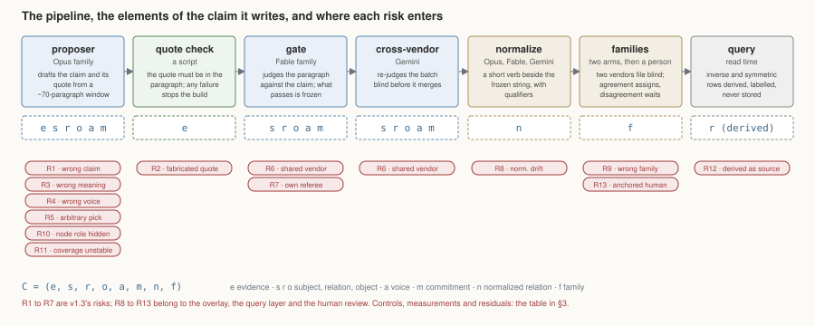
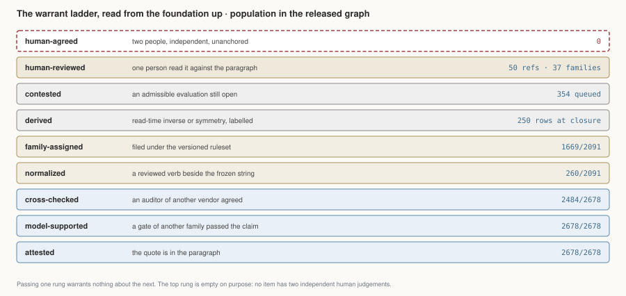
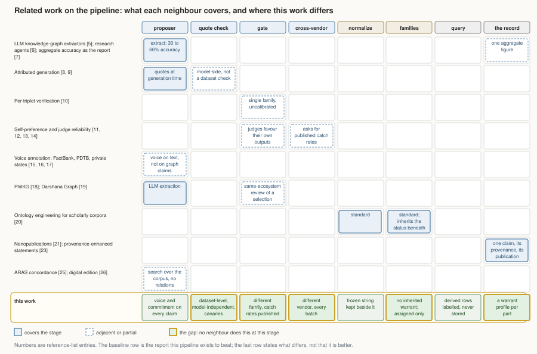

# Trust, Layered: Warranted AI Knowledge Extraction for Interpretive Corpora, Demonstrated on Jung's *Collected Works*

**Damian Spendel**
*AI use disclosure — tools and roles: Claude Opus (extraction), Claude Fable 5 (verification, and the drafting of this text), Gemini 3.1 Pro (cross-vendor audit, and the checking of every claim this text makes about the dataset), orchestration via Claude Code, all under the author's direction. The author is responsible for every claim.*

*v2.0 — September 2026 · DOI: [10.5281/zenodo.21631523](https://doi.org/10.5281/zenodo.21631523) · Artifact: [symbolicworld.observer](https://symbolicworld.observer) · Repository: [github.com/damianspendel/symbolic-world](https://github.com/damianspendel/symbolic-world), release `v2.0.0`*

---

## Abstract

We set out to map an interpretive corpus, Jung's *Collected Works*, as an
atlas a reader can browse: what he claims, of what, on whose authority, and
where. A machine draws such a map cheaply and makes mistakes of several
kinds: an invented quote, a claim the paragraph does not make, a hedge made
to sound certain, a fair reading filed under the wrong heading. So the
process that generates the map is built around those risks and their
mitigants. Each step is checked by a different model family or vendor from
the one that drafted the claim, and, where no machine can settle it, a
person. Every line then carries a receipt, its "warrant profile": which
checks it survived, who made them, and which nobody has made. Seeded
corruptions show the machine checks catch invented quotes and wrong claims
almost every time and most often miss a tentative claim whose caution has
been stripped away. The approach brings together, in one record per claim,
the checks that literature currently treats separately: attributed
quotation, verification of each claim by a second model, cross-vendor audit,
voice annotation and provenance. The claim is not that the map is right, but
that we hold a stated view of how far each claim has been checked, and where
we are not sure. That is where discussion belongs. Other interpretive
corpora can be mapped this way, the extraction automated and evidenced, so
that a scholar's reading goes to the claims the machines could not settle.

## 1. Claims are not triples

A knowledge graph publishes a triple and a status. For factual corpora that
is nearly enough, because the parts of a claim fail together: a wrong object
makes a wrong claim, and one verdict covers it.

Interpretive corpora do not behave that way. A published claim about a
passage of Jung's *Collected Works* (CW) has eight parts, and each can fail
while the others hold:

    C = (e, s, r, o, a, m, n, f)

*e* is the evidence (volume, paragraph, verbatim quote); *s* and *o* the
subject and object; *r* the relation as the source supports it; *a* whose
voice the claim is in; *m* how strongly it is committed; *n* the normalized
relation; *f* the family it is filed under. This is the order we use
throughout the paper.

The failures are independent, the red row of Figure 1. A quote can match its paragraph exactly under
a relation that overstates it. A relation can be right and the voice wrong,
so an alchemist's doctrine appears as Jung's position. Normalization can
drop a hedge without touching the quote. A family can be assigned correctly
to a relation whose subject and object were swapped when it was mined.
Checking one catches none of the others.

**Passing one layer warrants nothing about the next.** A single "verified"
label hides these independent failures: the reader takes one check for the
whole tuple. So the question this paper answers is not "is the graph
right?" but two smaller ones. How would we build an atlas in which each
part of a claim carries its own backing, a *warranted atlas*? And what
would a reader be told about one claim, its *warrant profile*?

## 2. Warranting claims

Six words are reserved in this paper and used in no other sense. A
*proposer* is the model that drafts a claim. A *gate* is a model of a
different family that judges the paragraph against the claim; what the gate
passes is *frozen*, its wording never rewritten. *Cross-vendor* means a
model from another company re-judged it blind. *Attested* means the quote is
in the paragraph; *adequate* means the quote supports the claim as stated,
which no machine settles. *Verified* means attested and gate-passed, and is
never said of a family.

Figure 2 is the pipeline that writes the eight parts. A proposer reads a
window of about seventy paragraphs and drafts claims with quotes: *e, s, r,
o, a, m*. A script checks the quote is in its paragraph. The gate reads the
whole paragraph and passes, corrects or rejects the claim; the cross-vendor
auditor re-judges the batch before it merges. Two more stages act on the
frozen claim without touching it: a normalizer writes a short verb beside a
relation that had grown into a sentence, with the carrier, scope, condition
and modality it displaced held as named qualifiers (*n*); two *arms*, models
of different vendors, file the relation under one of 25 families of a
versioned ruleset, and where they disagree a person rules (*f*). At query
time, declared inverse and symmetric rules derive rows that are labelled
derived and never stored. The rule under all of it: whatever proposes never
signs off. Proposer and gate are different families; the auditor is a
different vendor; the roles never swap. Each stage confers a *rung* on what
passes it, the italic row of the figure: attested, model-supported,
cross-checked, normalized, family-assigned, derived. A rung is a *warrant*,
the specific backing a part has, and passing one warrants nothing about
the next. Two rungs no stage confers, human-reviewed and human-agreed,
complete the set; §5 stacks them.

The artifact this writes is an assertion graph that carries its own
provenance, with a governed overlay. It is not an ontology, and the absences
are decisions: no class hierarchy, no closed predicates, no domain or range,
no transitivity. Nodes carry one of six coarse types and nothing is inferred
from the type. Every choice trades reasoning power for traceability.

### One edge

The **warrant profile** of a claim is the list of rungs it has reached and
the rungs it has not. Take `salt symbolizes the-self`, published in v1.3 and
unchanged since; Figure 3 lays it out.

The six parts the proposer wrote were passed by the Fable gate on
2026-07-25 and cross-checked in the full-volume audit two days later; the
wording is frozen from that day. The string is already a verb, so *n* is
empty. Two arms agreed on the family `symbolization` on 2026-08-07 and the
calibrated gate audited it on 2026-08-12; no person has ruled on it. At
read time the query `the-self symbolized-by salt` returns one row,
labelled `derived: inverse-of(symbolizes)`, stored nowhere.

Its profile: attested, model-supported, cross-checked, family-assigned by
agreement, not normalized, not human-reviewed, derivable. That sentence,
not "verified", is what the atlas says about it, and the same sentence is
computable for every one of the 2091 relations. The frozen wording matters
here: if the overlay ever misfiles this edge, the assertion beneath it is
untouched, and a reader can always fall back to the words the gate judged.

A warranted atlas therefore has no aggregate accuracy figure. It has a
profile per claim, and, summed over the graph, a profile per layer, which
§5 reports once the risks have been named (§3) and measured (§4).

## 3. Risks and controls along the pipeline

Figure 4 is Figure 2 with one more dimension: at each stage, the ways a
part of the claim can be wrong while the others hold. v1.3 named seven.
Five arise at the proposer: a wrong claim (R1), a fabricated quote (R2), a
wrong meaning (R3), a wrong voice or commitment (R4), an arbitrary
selection (R5). Two arise from the machinery built to catch them: checkers
that share a vendor with the writer (R6), and a referee that is one of our
own models (R7). This revision adds six: normalization drift (R8), a wrong
family (R9), a node type that hides the roles a node plays (R10), coverage
that shifts between runs (R11), a derived row read as a source claim (R12),
and a human review anchored by the label it is shown or done without the
expertise the text needs (R13). The table gives each its control, where §4
measures it, and what remains.

| # | Risk | At risk | Control | Measured | Residual |
|---|---|---|---|---|---|
| R1 | The claim is wrong: the paragraph does not say it | *r* | Structure gate, different family | §4.2 | none seen in audited samples |
| R2 | The evidence is fabricated | *e* | Deterministic quote check, elision bound, 7 canaries on every build | §4.1 | excluded within the checker's rules; adequacy not checked |
| R3 | The meaning is wrong: reversed, wrong object, analogy read as identity | *r, o* | Structure gate | §4.2 | near-referent drift caught 24 of 25; analogy-to-identity 18 of 25 |
| R4 | The voice or commitment is wrong | *a, m* | Voice gate, graph-wide sweep, human gold set | §4.3 | the dominant surviving risk: dropped hedges caught 10 of 25; human agreement 40 of 50, one annotator, anchored |
| R5 | The selection is arbitrary | which *C* exist | Union mining (a second pass whose new claims are added, never substituted), stability probe | §4.6 | no salience threshold defined; completeness not claimed |
| R6 | Proposer and checker share a vendor | all | Cross-vendor pass on every batch since the mandate | §4.2 | vendor separation is not epistemic independence |
| R7 | The referee is one of ours | all | Every ruling published; unanchored cross-review of the referee | §4.3, §7 | material: the auditor rejected 9/13 convention rulings |
| R8 | Normalization drift: the clean verb no longer says what the gate passed | *n* | Frozen *r* beside *n*; own proposer, gate and cross-check per record | §4.4 | measured once: dropped scope and hedge slip through |
| R9 | Family misclassification | *f* | Two arms file blind; disagreement goes to a person; a calibrated gate audits | §4.5 | gate is same-vendor as one arm; 37 human rulings; literature agreed on 8 of 16 treated |
| R10 | Node-role distortion: one type per node hides contextual roles | *s, o* | Six coarse types; nothing inferred from type | none | **unmeasured**; accepted design cost |
| R11 | Coverage instability across runs | which *C* exist | Repeat mining on held-out windows | §4.6 | 37.5% strict pair overlap; the rest model-classified |
| R12 | Derived rows read as source claims | *r* at query time | Derived rows labelled, never stored; no transitivity | §2 | 250 rows at closure, each naming its source edge |
| R13 | Human review anchored or under-qualified | *a, m* and every human rung | Unanchored protocol written; second annotator planned | §4.3 | the one human pass was anchored; annotator is the author |

Three rows should not be softened. R10 is unmeasured. R9 is where the
project breaks its own independence rule: the family gate is the same
model as one of the two arms, and every calibration record says so. And
R4, R7 and R13 share one residual: the only full mitigation is independent,
unanchored human judgement, which the artifact does not yet carry.

## 4. What we measured

One subsection per part of the claim, then the profile. Experiment numbers
point to Appendix A.

### 4.1 Evidence (*e*)

Every reference passes the deterministic check on every build: 2678 of
2678, 2849/2858 quote fragments matching exactly, the rest off by an absorbed
footnote marker. Each build must also reject 7 canaries or it
stops. It failed once: a hostile review found 16 quotes whose ellipses skipped more than the bound allowed,
plus 2 in the James pilot (38 edges, all 38 published, E8); all were
repaired. Within the declared rules, a quote in the atlas is in the book.
Whether it is the right quote, the checker cannot know.

### 4.2 Support (*s, r, o*)

Seeded corruption [1, 2] measures what the gate catches. On coarse seeds (E1b: 200 items, random object swaps, a literal
`is-identical-to`) sensitivity was 86 of 100, specificity 93 of 100. Study B
seeded the subtler errors audits had found (200 items, pre-registered): near-referent drift caught 24 of 25, a subject
widened to its class 24 of 25, an analogy hardened into identity 18 of 25,
a deleted hedge 10 of 25; pooled sensitivity 76 of 100 (95% interval 67 to
83), specificity 88 of 100. Reference and structure are defended on realistic errors about as well
as on crude ones; overstated commitment slips through, moving the residual
from *r* and *o* to *m*.

Cross-vendor audits found the drift first: on the full CW 14
volume (E7) the auditor's findings upheld at 1.0% under the project's
conventions, 2.2% under its own strict reading, none a fabrication or
reversal. Every batch since carries a pre-merge cross-vendor pass: 93% of
references today, 412 of CW 14's 413. Two limits: the auditor had the
project's rubric, and vendor separation is not independence.

### 4.3 Voice and commitment (*a, m*)

The weakest layer, where the human found what models could not.
On seeded voice flips the gate catches 18 of 25, a narrow voice-only gate
20 of 25 (E5b, unresolved); a graph-wide sweep corrected 65
of 634 references (E3). Both vendors missed the same ones.

The author then read 50 references against their full paragraphs (E10):
44/50 supported, 5 partly, 1 not; voice 40/50 agreed, per class asserts
24/26, quotes 8/9, reports 8/15, 8 of 10 disagreements moving the label
away from Jung's voice. Six shared a pattern no model audit had
surfaced: a named source filed as anonymous tradition. Three limits: one
annotator, not a specialist; an anchored review, which inflates agreement;
a draw not seed-reproducible. Counting reserved agreements as disagreements puts
voice at 35 of 50; the honest range is 70 to 80%, and because the reader
saw the label first it is an upper bound on agreement with the pipeline,
not a validation. Until an independent reader annotates blind, the voice
layer has no human baseline, and the top rung of §5 says so.

The referee fares no better: re-reviewed blind by the second vendor, its
rulings kept every concrete correction and lost 9 of the 13
convention-based rulings.

### 4.4 Normalization (*n*)

260 relations carry a normalized form, proposed by Opus, gated by Fable
for entailment against the frozen claim, checked by Gemini. Study C
(pre-registered) is the layer's first
instrument: a model from the other vendor re-normalized all 260 blind, and
the arms state the same relation on 217 of 260 (83.5%), most differences
one arm keeping a hedge or restriction the other lost. Then 40 corrupted normalizations among 40 clean: strengthened verb and
reversed direction caught 10 of 10 each, dropped scope 1 of 10, dropped
modality 2 of 10; 37 of 40 clean passed. As in
Study B, structure is defended, commitment and scope are not.

### 4.5 Families (*f*)

The arms agree on 1699 of 2076 relations they both filed (81.8%), agreement
on no family counted; of the rest, a person has ruled 37 and 340 wait. Agreement shows the ruleset is followable,
not right.

The family gate is calibrated by planting 19 errors among 60 assignments,
all to be caught with the family named. Ruleset
v0.7.2, pooled over four draws, caught 73 of 76 and left 159 of 164 clean
assignments alone; PASS came on the fourth draw. The gate is the same model as one of
the arms. What the calibration measures is the catching of planted errors,
not the judging of that arm's own output; the risk the shared vendor
carries is leniency in production audits, which no calibration record
can see, and R9 lists it as the residual.

Against eight works of scholarship, Edinger's among them [3, 4], 27
items were drawn and 22 assignments scored; the works treated 16: 8 agreed, 6 disagreed, 2
split the scholars. Amplification disagreed on all three sampled items and
seven rulings followed. The sample was enriched with contested families,
so this is formative, not validation.

### 4.6 Selection and coverage

Two windows re-mined blind with a twenty-relation budget (E4) gave 37.5%
strict pair overlap; core claims recur, and a model, not a person,
classified the rest. Coverage per volume is in Appendix C;
completeness is not claimed.

## 5. What the atlas can warrant

Three views of one result. Figure 5 is Figure 4's risks coloured by what
§4 could establish; the rubric follows the §3 table. Three risks are
green, nine amber, one red, and the amber band is the finding: reference
and structure are defended, commitment and scope are open, and the human
rungs are empty.

Summed over the graph, one line per layer, in place of an accuracy figure:

| Layer | Warrant the atlas can state | Measured how |
|---|---|---|
| *e* | every quote is in its paragraph under the declared rules | deterministic, every build |
| *s, r, o* | coarse structural error caught at 86%, realistic drift at 24 of 25; upheld error 1.0 to 2.2% on one full volume | seeded corruption (E1b, Study B); cross-vendor audit |
| *a, m* | 70 to 80% agreement with one anchored human reader, an upper bound; reports class 8 of 15; dropped hedges caught 10 of 25 | author gold set; Study B |
| *n* | two vendors agree on 217 of 260; gate catches structure 10 of 10, dropped hedge or scope 1 to 2 of 10 | Study C |
| *f* | 81.8% arm agreement; gate catches 73 of 76 planted errors, same vendor as one arm; 8 of 16 agree with secondary literature | arms, calibration, literature |
| selection | 37.5% strict overlap on re-mining; no completeness claimed | stability probe |
| human | 50 references and 37 families reviewed by one person; 0 by two | count |

Figure 6 stacks the rungs, read from the foundation up, with the number
of claims that have reached each. Attestation is the
one warrant a machine settles completely, and it settles only that the
words are in the book. Above it sit the judgements: a gate of another
family, an auditor of another vendor, one person, two people. Beside them
sit the overlay's warrants, normalized and family-assigned, which inherit
nothing from the layers beneath: a family is *assigned*, never verified.
Derived and contested are states rather than backings, and they are printed
because a reader needs them. The top rung is empty on purpose. No item in
this graph has been judged by two people independently, and the rung exists
so that the gap is seen rather than absorbed into the rung below it.

Read together: a claim's profile (§2) is its own row through Figure 6;
the table is the graph's; and Figure 5 says which rows can still move.

## 6. Six questions, answered from the graph

A profile is only useful if the atlas answers questions with it. Six, each
one command against the released files, output quoted from the run.

*What does Jung himself assert symbolizes the self?* 22 relations
(`--object the-self --relation symbolizes --claim-type jung-asserts`):
lapis, Christ, the rebis, salt, Mercurius among them, each with its
paragraphs.

*Which claims about Mercurius come from named sources rather than Jung?*
5 relations carry `jung-quotes-source` references, and the register
matters: the named sources say Mercurius is made equal to Mary or dwells at
the celestial Pole; Jung's own register elsewhere is manifestation and
identification.

*What exists only through derivation?* At full closure the graph answers
with 2341 rows, 2091 stored and 250 derived, every derived row labelled
with its source edge and rule.

*What is contested?* 354 relations, listable by `--state
pending-adjudication`, 340 of them on arm disagreement.

*What has a person ruled on?* 39 rows carry human provenance
(`--provenance human`): 37 adjudications, one precedent, and one record
that asks for a human ruling after five calibration appearances.

*What does the newest volume say about synchronicity?* Four relations, all
from CW 8 or its convergence in CW 14: synchronicity complements causality
(CW 8 §827, CW 8 §840), dispenses with it (CW 8 §855), rests on absolute
knowledge (CW 8 §857, CW 8 §858), and corresponds to the unus mundus (CW 14
§662). The graph keeps the complementary and the acausal readings apart
because the paragraphs do.

Each answer cites its edges, so a wrong answer is a disputable answer.

## 7. Disagreement is a valid output

The fourth and fifth answers above are not defects in the atlas. A pipeline
that forces every disagreement to one label destroys information, and this
one keeps three kinds on the surface.

The arms disagree. 340 relations carry two family opinions that do not
match, and no model breaks the tie. They are published as
`pending-adjudication` with both votes visible, and they stay published
while they wait. Rulings are slow on purpose: each is signed and dated, and
most force a sentence into the ruleset. Precedent applies only where the
reasoning matches; the one time this was measured, a ruling expected to
clear nine queued items cleared one.

The vendors split on conventions. When the second vendor re-reviewed the
orchestrator's rulings without the rationales, it kept every concrete
correction and rejected 9/13 convention rulings. Models converge on defects
and diverge on policy, so convention-based resolutions are labelled as
conventions, with an audit note where an auditor was overruled; 39
references carry such a note.

The scholars disagree too. Of the 16 family assignments the secondary
literature treated, 2 split the consulted scholars against each other, and
the boundary that defeats every model configuration, Jung reporting
alchemical doctrine and half adopting it, is the same boundary those
scholars argue over. That is not noise around a right answer. It marks the
places where a knowledge graph of an interpretive author cannot be more
settled than the scholarship, and a warrant profile lets it say so instead
of picking. A richer voice model is the next step and is proposed, not
built: reported source, author commitment, embedding depth, and an adoption
marker in place of three mutually exclusive labels.

## 8. Limitations, and what stays open

The quotes are bound to one translation, the Hull Bollingen edition; a
German cross-check has not run. The one human validator is the author, who
does not claim professional Jung scholarship, and reviewed anchored. Rights
constrain the artifact: the corpus is not shipped, quotes stop at 25 tokens,
and a reader needs the books to dispute deeply. The models are commercial
APIs, non-deterministic and subject to drift; verdicts are dated and
model-stamped, but a re-run is not guaranteed to reproduce them. The ruleset
evolves, and by rule its numbers are voided on every change. The family
layer is interpretive all the way down: 25 families are one defensible
carving. Coverage is uneven by an order of magnitude across volumes. The
dispute channels select for readers who already care. And inspectability
is not correctness: everything here makes error findable, nothing makes it
absent.

Six measurement questions organized the work. Three are answered in part
and three stay open; the studies that would settle them are designed in the
repository, and the first is the keystone, because every other study's
scoring ends in a human judgement that does not yet exist.

- How well do the gates catch each error class: answered for coarse and
  realistic errors (§4.2); open for dropped hedges.
- Do model verdicts agree with unanchored human judgement: open. Study A,
  two or more annotators, one a Jung specialist, label-blind.
- Does normalization preserve meaning and qualifiers: measured once (§4.4);
  open for hedge and scope.
- Are family assignments stable across models, people and literature:
  partly (§4.5); open until a held-out sample tests the frozen ruleset.
- How stable and complete is extraction under repeated mining: partly
  (§4.6); open until a human-coded window gives a recall figure.
- Which findings survive a change of corpus: one pilot on friendly ground
  (E8); open until a third corpus with a different discourse structure.

## 9. Related work

Benchmarked large language model (LLM) extractors run at 30 to 66% accuracy
on knowledge-graph extraction [5], and deployed research agents hallucinate
11 to 57% of citations [6]; aggregate accuracy remains the usual report
[7]. That is the baseline this pipeline exists to beat, and the risks of §3
are drawn from that literature.

Each control in Figure 2 has a near neighbour; Figure 7 maps them onto the
pipeline. Attributed-generation systems enforce
quotation at generation time [8, 9]; we enforce it at dataset level, as a
deterministic check independent of any model. Per-claim anchoring with
per-triplet verification appears elsewhere with a single-family,
uncalibrated verifier [10]; the self-preference literature, where judge
models favor their own outputs [11, 12], motivates the line that proposer
and gate are different families and the auditor a different vendor, and
the judge-reliability literature asks for exactly the published catch rates
we report [13, 14]. Voice annotation has deep roots in FactBank's
source-relative factuality [15], the Penn Discourse Treebank (PDTB)
attribution layer [16] and the annotation of private states [17], but
knowledge-graph extraction leaves claims untyped [5]. PhilKG reviews a
selection of LLM extractions with a stronger same-ecosystem model [18]; the
Darshana Graph names a sampled precision evaluation as its most valuable
next step [19]. Normalization and classification are standard in ontology
engineering, including for scholarly corpora [20]; keeping them from
inheriting the evidential status of the layer beneath is, to our knowledge,
not.

The gap the figure marks is not a better extractor. It is checking at
dataset level by a gate of a different family and an auditor of a
different vendor, with catch rates published; voice and commitment typed
on every claim; and an overlay that inherits no warrant, with a profile
per part where a provenance record would carry one line.

The reference format borrows the anatomy of nanopublications [21], the
minimal citable unit of one claim with its provenance and publication
record, a form with almost no humanities uptake [22]. The warrant profile is
what that provenance slot becomes for interpretive claims: not one record of
where a claim came from but a layered one, stating which kinds of checking
it has survived. It treats voice as epistemic stance in the sense of
provenance-enhanced statements [23], and the graph as what Drucker calls
*capta*, data taken by an interpreter rather than given [24]. To our
knowledge no knowledge graph of the *Collected Works* existed before; the
ARAS concordance [25] and the digital edition [26] are search, not relations.

## 10. Conclusion

The method does not automate scholarly consensus, and stops claiming
anything adjacent to that. What it does is narrower and, we think, more
useful: it makes machine-proposed interpretive claims inspectable,
separately warranted at each layer from quotation to classification,
revisable in public, and able to carry disagreement without silently
converting it into fact. The atlas that demonstrates this spans nine volumes
and 2678 verified references, and its weakest layers are labelled as
clearly as its strongest. Where evidence ends and interpretation begins is,
in a warranted atlas, a queryable property of every published claim. That,
not the graph's size, is the contribution.

## Appendix A. Experiments, indexed

One line per experiment; full details, inputs and verdicts ship in the
repository under `docs/experiments/`.

E0 retro-verification of 238 ungated references (25.2% alarm rate). E1/E1b
seeded-corruption calibration of the gate (n=200; sensitivity 86%,
specificity 93%). E2 adversarial audit, 30 references, no content errors.
E3 graph-wide modality sweep (10.3% corrected). E4 stability probe (37.5%
strict pair overlap). E5/E5b voice-specialist calibration (20/25 vs 18/25,
unresolved). E6 cross-vendor stratified audit (n=100; 4 upheld). E7
full-volume reduced-rubric audit (n=407; 1.0 to 2.2% upheld). E8 James
pilot (38 published edges, calibration replicated). E9 teaching test (flags
7/20 to 3/20, confounded by shared judge). E10 author gold set (n=50;
support 44/50, voice 40/50). Study B realistic corruption calibration
(n=200, pre-registered; sensitivity 76%, specificity 88%;
`docs/experiments/study_b/`). Study C normalization validation
(pre-registered; second arm agrees on 217/260, corruption catch 23/40 with
specificity 37/40; `docs/experiments/study_c/`). Family-gate calibrations
v0.5 through v0.7.2, all runs, in `pipeline/family_calibration/records/`.

## Appendix B. One record, in full

The §2 example as it is stored. Edge: `salt symbolizes the-self`. Reference:
volume 14, paragraph 329, twelve-word quote, `claim_type: jung-asserts`,
`confidence: medium`, `verified: true`, `verified_by: claude-fable-5`,
`verified_date: 2026-07-25`, `crossvendor_checked: gemini-3.1-pro (E7
full-volume audit, rubric-free, 2026-07-27)`. Family record: `value: symbolization`,
`state: assigned`, `by: opus+gemini-agreed`, `date: 2026-08-07`, `audit:
v0.7.1 gate SUPPORTED 2026-08-12`. No `relation_normalized`. Derived at
read time: `the-self symbolized-by salt`, labelled
`derived:inverse-of(symbolizes)`, stored nowhere.

## Appendix C. The graph as shipped

Counts bind to `seed.json` at the release and regenerate on every build.
589 nodes (231 Concept, 139 Figure, 93 Symbol, 69 Motif, 33 Operation, 24
Substance), 2091 relations, 2678 references, all attested and
gate-verified; the references split 2148 asserts / 381 reports / 149
quotes-source, 293 hedged at medium confidence, and cite 1798 distinct
paragraphs.

Coverage, stated per volume as paragraphs cited over paragraphs in the
volume: 35% of CW 14's paragraphs (276 of 791), end to end. CW 12, at 30%
(168 of 565), end to end. CW 13, 134 of 482 (28%), end to end. CW 9ii, 212
of 429 (49%), end to end. CW 9i, 386 of 715 (54%), end to end. CW 8, 570 of
997 (57%), end to end, fourteen windows. CW 5, 11 and 16 are three
thinly-sampled volumes, at 2 to 3% each, and carry no coverage claim. Eleven
volumes are untouched. Citation share is not salience: no volume is claimed
complete at any threshold (§4.6).

The release pin: graph v2.0, ruleset v0.7.2, calibration record
`pipeline/family_calibration/records/2026-08-13_v072_run4.json` (PASS,
with the full run series and pooled figures beside it).

### References

1. Thorne, J., Vlachos, A., Christodoulopoulos, C., & Mittal, A. (2018). FEVER: A Large-scale Dataset for Fact Extraction and VERification. *NAACL 2018.* arXiv:1803.05355. <https://arxiv.org/abs/1803.05355>
2. Ribeiro, M. T., Wu, T., Guestrin, C., & Singh, S. (2020). Beyond Accuracy: Behavioral Testing of NLP Models with CheckList. *ACL 2020.* arXiv:2005.04118. <https://arxiv.org/abs/2005.04118>
3. Edinger, E. F. (1995). *The Mysterium Lectures: A Journey Through C. G. Jung's Mysterium Coniunctionis.* Inner City Books. <https://archive.org/details/mysteriumlecture0000edin>
4. Edinger, E. F. Review of C. G. Jung, *Mysterium Coniunctionis*. *Journal of Analytical Psychology*; as quoted in the publisher's description of CW 14. <https://www.abebooks.com/9780691097664/Collected-Works-Jung-Vol-Mysterium-0691097666/plp> (accessed July 2026).
5. Mo, B., Yu, K., Kazdan, J., Cabezas, J., Mpala, P., Yu, L., et al. (2025). KGGen: Extracting Knowledge Graphs from Plain Text with Language Models. *NeurIPS 2025.* arXiv:2502.09956. <https://papers.neurips.cc/paper_files/paper/2025/file/2b368455e832d2b1a60bcad8c4c6481f-Paper-Conference.pdf>
6. Onweller, H., Lumer, E., Huber, A., Ramchandani, P., Subbiah, V. K., & Feld, C. (2026). Cited but Not Verified: Parsing and Evaluating Source Attribution in LLM Deep Research Agents. arXiv:2605.06635. <https://arxiv.org/abs/2605.06635>
7. Han, H., Ma, L., Wang, Y., Shomer, H., Lei, Y., Qi, Z., et al. (2025). RAG vs. GraphRAG: A Systematic Evaluation and Key Insights. arXiv:2502.11371. <https://arxiv.org/abs/2502.11371>
8. Schreieder, T., Schopf, T., & Färber, M. (2025). Attribution, Citation, and Quotation: A Survey of Evidence-based Text Generation with Large Language Models. *ACL 2026.* arXiv:2508.15396. <https://arxiv.org/abs/2508.15396>
9. Yeginbergen, A., Wührl, A., Rogers, A., & Agerri, R. (2026). Explicit Evidence Grounding via Structured Inline Citation Generation. arXiv:2606.07130. <https://arxiv.org/abs/2606.07130>
10. Yang, Y., Chen, G., He, B., & Zhao, Y. (2026). Grounded Knowledge Graph Extraction via LLMs: An Anchor-Constrained Framework with Provenance Tracking. *Computers* 15(3), 178. MDPI. <https://www.mdpi.com/2073-431X/15/3/178>
11. Wataoka, K., Takahashi, T., & Ri, R. (2024). Self-Preference Bias in LLM-as-a-Judge. *NeurIPS 2024 Safe Generative AI Workshop.* arXiv:2410.21819. <https://arxiv.org/abs/2410.21819>
12. Zhang, Y., Wang, C., Wu, L., Yu, W., Wang, Y., Bao, G., & Tang, J. (2025). UDA: Unsupervised Debiasing Alignment for Pair-wise LLM-as-a-Judge. arXiv:2508.09724. <https://arxiv.org/abs/2508.09724>
13. Dev, S., Sloan, A., Kavner, J., Kong, N., & Sandler, M. (2026). Judge Reliability Harness: Stress Testing the Reliability of LLM Judges. *ICLR 2026 Workshop: Agents in the Wild.* arXiv:2603.05399. <https://arxiv.org/abs/2603.05399>
14. Lee, C., Zeng, T., Jeong, J., Sohn, J., & Lee, K. (2025). How to Correctly Report LLM-as-a-Judge Evaluations. *ICML 2026.* arXiv:2511.21140. <https://arxiv.org/abs/2511.21140>
15. Saurí, R., & Pustejovsky, J. (2009). FactBank: A Corpus Annotated with Event Factuality. *Language Resources and Evaluation* 43. <https://link.springer.com/article/10.1007/s10579-009-9089-9>
16. Prasad, R., Webber, B., Lee, A., & Joshi, A. (2019). Penn Discourse Treebank Version 3.0. LDC2019T05. Linguistic Data Consortium. <https://catalog.ldc.upenn.edu/LDC2019T05>
17. Wiebe, J., Wilson, T., & Cardie, C. (2005). Annotating Expressions of Opinions and Emotions in Language. *Language Resources and Evaluation* 39. <https://link.springer.com/article/10.1007/s10579-005-7880-9>
18. PhilKG (submission under public review; figures cited from the submission and its review discussion). OpenReview forum yvk5HRVGQr. <https://openreview.net/forum?id=yvk5HRVGQr> (accessed 28 July 2026).
19. Bose, J. (2026). Darshana Graph: A Parallel Commentary Corpus for Comparative Indian Philosophy, with Stylometric and Exploratory Graph Analyses. arXiv:2606.18222. <https://arxiv.org/abs/2606.18222>
20. Schimmenti, A., Pasqual, V., Vitali, F., & van Erp, M. (2025). Knowledge Graphs Generation from Cultural Heritage Texts: Combining LLMs and Ontological Engineering for Scholarly Debates. arXiv:2511.10354. <https://arxiv.org/abs/2511.10354>
21. Kuhn, T., Meroño-Peñuela, A., Malic, A., Poelen, J. H., Hurlbert, A. H., Centeno Ortiz, E., et al. (2018). Nanopublications: A Growing Resource of Provenance-Centric Scientific Linked Data. *IEEE eScience 2018.* arXiv:1809.06532. <https://arxiv.org/abs/1809.06532>
22. Haslhofer, B., Isaac, A., & Simon, R. (2018). Knowledge Graphs in the Libraries and Digital Humanities Domain. arXiv:1803.03198. <https://arxiv.org/abs/1803.03198>
23. Vitali, F., & Pasqual, V. (2026). Provenance-Enhanced Statements in Knowledge Graphs. arXiv:2606.15246. <https://arxiv.org/abs/2606.15246>
24. Drucker, J. (2011). Humanities Approaches to Graphical Display. *Digital Humanities Quarterly* 5(1). <https://www.digitalhumanities.org/dhq/vol/5/1/000091/000091.html>
25. ARAS Concordance (search tool for Jung's Collected Works by keyword). Archive for Research in Archetypal Symbolism. <https://aras.org/concordance> (accessed July 2026).
26. *The Collected Works of C. G. Jung: Revised and Expanded Complete Digital Edition.* Princeton University Press, 2023. <https://press.princeton.edu/books/ebook/9780691255194/the-collected-works-of-c-g-jung>

